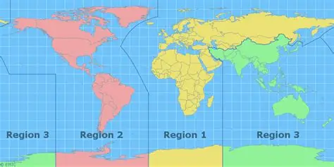
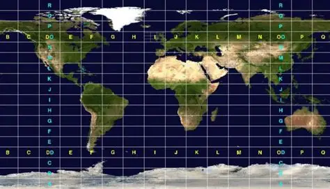
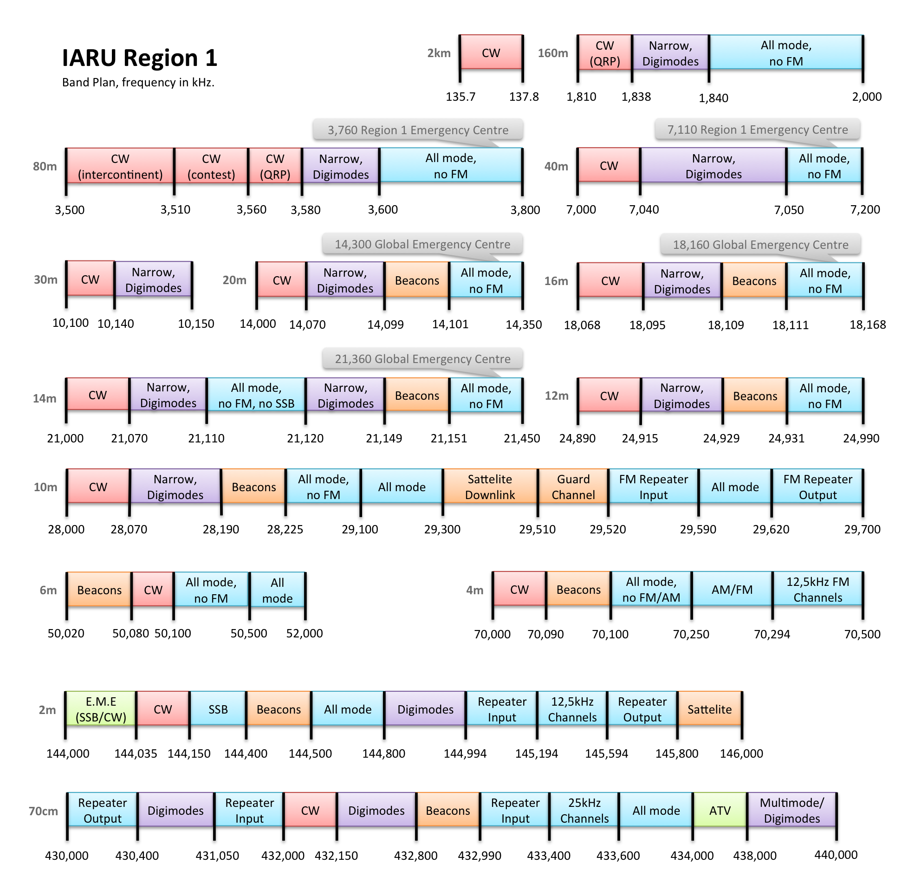
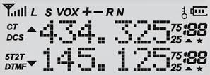

# Rádióamatőr vizsgára felkészítő tanfolyam

5. Fejezet: Forgalmi ismeretek

Mai előadó: Urbán Dániel - HA5UDS

Készült: [marp](https://marp.app/) [vscode](https://code.visualstudio.com/) [github](https://github.com/durban77/hamcourse)

---

# Tanfolyam

```markdown
* Bevezető alkalom
* Általános tárgykör / Matematikai és fizikai alapok
* Műszaki tárgykör / Villamosság-, elektromágnesesség-, és rádióelmélet
* Műszaki tárgykör / Alkatrészek
* Jogi tárgykör / Jogi anyag
* Forgalmazási tárgykör / ▶ Forgalmi ismeretek ◀
* Műszaki tárgykör / Áramkörök
* Műszaki tárgykör / Vevők
* Műszaki tárgykör / Adók
* Műszaki tárgykör / Antennák és tápvonalak
* Műszaki tárgykör / Hullámterjedés
* Műszaki tárgykör / Mérések
* Műszaki tárgykör / Zavarás és védelem
* Biztonságtechnika / Villamos biztonságtechnika
```

---

# Témakörök

* Forgalmazásnál használt betűk
* Q-kódok
* Forgalmazási rövidítések
* Nemzetközi vészjelek, veszélyhelyzeti forgalom, kommunikáció természeti csapás esetén
* Hívójelek
* Sávtervek
* Társadalmi felelősség

---

## Bevezető

    A rádióamatőrök tegeződve, egymást keresztnéven szólítva kommunikálnak.

Azonos keresztnév esetében vagy társaságban a hívójelet használjuk segítségnek. `pl: Dani, HA5UDS Dani, 5UDS Dani, 5UDS`
Ismeretlen név esetén OM (:older_man: amatőrtárs) vagy YL (:woman: amatőr hölgy) megnevezéssel élünk.
Írásban a :seven::three: rövidítéssel köszönünk el. Jókívánságainkat nagy távolságú összeköttetéseket kívánva fejezzük ki (`DX`).

:information_source: Forgalmazási ismeretek leginkább megfigyléssel sajátíthatók el. :headphones:

---

## Nemzetközi betűzési ábécé

|Betű|Betű|Betű|Betű|Betű|
|----|----|----|----|----|
|A=Alpha|B=Bravo|C=Charlie|D=Delta|E=Echo
|F=Foxtrot|G=Golf|H=Hotel|I=India|J=Juliet
|K=Kilo|L=Lima|M=Mike|N=November|O=Oscar
|P=Papa|Q=Quebec|R=Romeo|S=Sierra|T=Tango
|U=Uniform|V=Victor|W=Whiskey|X=X-ray|Y=Yankee
|Z=Zulu|0=Zero|1=One|...|9=Niner|

---

## DX betűzési ábécé  _(ez nem vizsga anyag)_

```
    A......AMERICA, Amsterdam                       B......BOSTON, Baltimore, Brazil   
    C......CANADA, Columbia, Chile                  D......DENMARK
    E......ENGLAND, Egypt                           F......FRANCE, Finland
    G......GERMANY, Guatemala, Geneva, Greece       H......HONOLULU, Hawaii
    I......ITALY                                    J......JAPAN
    K......KILOWATT, Kentucky, King                 L......LONDON, Lima, Luxembourg
    M......MEXICO, Montreal                         N......NORWAY, Nicaragua
    O......ONTARIO, Ocean,                          P......PORTUGAL, Pacific
    Q......QUEBEC, Queen                            R......RADIO, Romania, Russia
    S......SANTIAGO, Spain, Sweden                  T......TOKYO, Texas
    U......UNITED, URUGUAY                          V......VICTORIA, Venezuela
    W......WASHINGTON                               X......X-RAY
    Y......YOKOHAMA                                 Z......ZANZIBAR, Zulu
```
---

## Magyar betűzési ábécé


---

|Betű|Betűzőszó|Betű|Betűzőszó|Betű|Betűzőszó|
|:--:|---------|:--:|---------|:--:|---------|
|A|Aladár, Antal|J|János|S|Sándor|
|B|Béla|K|Károly|T|Tamás|
|C|Cecil|L|László|U|Ubul|
|D|Dénes|M|Mátyás, Mihály|V|Viktor|
|E|Elemér|N|Nelli|W|dupla-Vilmos|
|F|Ferenc|O|Olga|X|ikszes (xilofon)|
|G|Géza|P|Péter|Y|ipszilon|
|H|Helén|Q|Kvelle|Z|Zoltán|
|I|Ilona|R|Róbert|0-9|egyes,kettes,...|

---

## Q kódok :fax:

* Három betűs kód, az első betűje Q.
* QRA-QUZ tartomány. :airplane: :ship: :radio:
* Kérdő és kijelentő mód. :question: :exclamation:
* Nyelvfüggetlen és rövid. 

[ARRL összefoglaló](https://www.arrl.org/files/file/Get%20on%20the%20Air/Comm%20w%20Other%20Hams-Q%20Signals.pdf)

---

### Q kódok - példák, gyakran használt kódok

|Kód|Jelentése|Kód|Jelentése|Kód|Jelentése|
|:-:|---------|:-:|---------|:-:|---------|
|`QSO`|összeköttetés|`QTH`|hely|`QSY`|frekvencia változtatás|
|`QRL`|foglalt  |`QRM` `QRN`|zavarás, zaj|`QRO` `QRP`|növelés, csökkentés|
|`QRS`|lassabban|`QRT`|adás vége|`QRV`|hallgat|
|`QSB`|hullámzás|`QSL`|nyugta|`QRZ`|hívó|

---

## Forgalmi rövidítések

Q kódokkal nem leírt, de mindennaposan használt rövidítések.

|Kód|Jelentése|Kód|Jelentése|
|:-:|---------|:-:|---------|
|`CQ`|általános hívás|`DE`|_hívó előtagja_|
|`R`|vettem|`PSE`|kérem|
|`K`|adjon|`TX`/`RX`|adás/vétel|
|`DX`|távoli összeköttetés|`RST`|_riport_|
|`73`|üdvözlettel|`HI`|:smiley::smile::grin:|

---

### Riport adás/vétel

||Értékek|Jelentés|Mikor adjuk?|Hogyan számítjuk?|
|:-|-:|-|:-:|-|
|**R**eadability|1-5|érthetőség|mindig|:hear_no_evil: _füllel_|
|**S**trength|1-9|jelerősség|nem átjátszón, ha van műszer||
|**T**one|1-9|hangszín|távírónál|:notes:|

Versenyen nem ritka a 5/9 riport vagy távírón a 5NN.

---

### Idő megadása :watch:

:clock130: **UTC** -t használunk az amatőr rádiózásban. Magyarországon jelenleg télen az UTC+1-es, nyáron pedig UTC+2-es időt használnak.

:satellite: GPS idő a helymeghatározó műholdak rádiójeléből vett pontos idő.

:computer: NTP számítógépes hálózaton szerzett pontos idő.

:radio: RWM 4.996, 9.996 és 14.996 MHz-en vehető. DCF77, [HGA22](https://en.wikipedia.org/wiki/Radio_clock)

---

### Helymegadás rövidítése :earth_africa:

|IARU régiók, 1-3|QTH (maidenhead) lokátor|
|-|-|
|||
||[JN97ML](https://www.egloff.eu/qralocator/)|

---

## Hívójelek :telephone_receiver:

**Prefix**, ami azonosítja az országot/régiót; utána az állomást és/vagy operátort azonosító egyedi betű/számsor. 
Betűk az angol ábécé 26 karaktere, számok a tízes számrendszer számjegyei.

    0=O és 1=I hasonlóság miatt az első karakter O illetve I lehet, nulla vagy egy nem.

Tovább kiegészíthető:
|/P = kitelepült|/M = mozgó|/MM = vízi mozgó|/AM = légi mozgó|
|-|-|-|-|

---

## Nemzeti azonosító jelek (prefix-ek) [:japan:](eu-map.jpg)

|Ország|Prefix|Ország|Prefix|
|-|-|-|-|
|Ausztria|OE|Horvátország|9A|
|Magyarország|HA, HG|Románia|YO-YR|
|Szerbia|YT-YU|Szlovákia|OM|
|Szlovénia|S5|Ukrajna|EM-EO, UR-UZ|
|Franciaország|F|Németország|DA-DD DF-DH DJ-DL DP|
|Bulgária|LZ|Lengyelország|SP SN-SR|
|Csehország|OK|Olaszország|I|

szomszédos országok és az európai országok prefixei

---

## Különleges állomások hívójelei :trophy::fox_face:

A versenyállomás hívójele `(HA|HG)[0-9][A-Z]`

A rádiós tájfutó versenyen elhelyezett amatőrállomás hívójele csak [MO, MOE, MOI, MOS, MOH vagy MO5](https://www.iaru-r1.org/wp-content/uploads/2021/06/ARDF-Rules_B_2020.pdf) lehet.

|Hívójel|Morze kód|Hívójel|Morze kód|Hívójel|Morze kód| 
|-|-|-|-|-|-|
|MO|`-- ---`|MOE|`-- --- .`|MOI|`-- --- ..`|
|MOS|`-- --- ...`|MOH|`-- --- ....`|MO5|`-- --- .....`|

---

## amatőrszolgálatok frekvenciasávjai :1234:

* [Magyarországon kijelölt amatőr sávok](https://stir.nmhh.hu/publicview/?p=d&name=3melleklet&lang=1#jump_to_3557)



---

## Sávtervek :soon: :end: _(ajánlás)_

IARU sávtervek útmutatást adnak az amatőr sávok hatékonyabb kihasználásához.
A sávterv célja, hogy az adó és a vevő megtalálja egymást, mindkét oldal hasonló célra hasonló frekvenciát válasszon és a sávon belül ugyanúgy helyezkedjen.
[Sávterv az IARU 1-es régióra](https://www.iaru-r1.org/on-the-air/band-plans/)

    A nemzeti előírások ezt felülírhatják, eltérhetnek tőle.

Különleges helyzetben, ha indokolt, ettől el lehet térni.

---

### Példa, 10m sávterv az egyes régióban

|CW 200|Digimode 500|Beacon 2700|⩝,noFM 2700|All mode|🛰 :satellite: downlink|:guard: guard|
|-|-|-|-|-|-|-|
|28.000-|28.070-|28.190-|28.225-|29.000-|29.300-|29.510-|

|FM repeater in|All mode|FM repeater out| <- BW: 6000|
|-|-|-|-|
|29.520-|29.590-|29.620-|-29.700|

|CW DX|CW verseny|CW QRS|CW QRP|
|-|-|-|-|
|kontinens közti|gyors forgalom|lassú forgalom|kis teljesítmény|

---

### Hasznos tudnivalók :thought_balloon:

* Sávterv mindig legyen előtted, fejben, kijelzőn, papíron.
* SSB 10 Mhz alatt LSB, felette USB. A beállított frekvenciához képest -+3kHz -n is fogsz adni.
* Digimód szinte mindig USB-ben megy, még 10 MHz alatt is.
* Ismételd meg többször is a hívójeledet, betűzve is.
* Ellenőrizd a kimenő adásodat, ha teheted!

---

## Nemzetközi vészjelek, veszélyhelyzeti kommunikáció :sos:

```
Távíró módban : ··· ─ ─ ─ ···      Távbeszélő módban : MAYDAY MAYDAY MAYDAY
```

A sáv hívó vagy vészhelyzeti frekvenciáján, teljesítményt magasabbra véve háromszor megismételve a vészhelyzeti jelzést.

Melyik sávot válaszd? :sunny: :moon: :cyclone: :mount_fuji: :deciduous_tree: :european_castle: Sávváltásodat mondd be!

A veszélyhelyzet pontos, rövid ismertetése (hely, veszélyhelyzet, segítségkérés) után kérj nyugtát a fogadó állomástól!

Fogadó állomásként, naplózd és továbbítsd az üzenetet.

---

## Társadalmi felelősség :two_men_holding_hands: :couple: :two_women_holding_hands:

Rádióamatőrként jelentős hatással leszel a világra, egy csodás lehetőséget kapsz arra, hogy mások életét befolyásold. A szabályok betartása rajtad fog múlni, tevékenységeddel öregbítsd az amatőrök jó hírét!
Képezd, fejleszd magad és mások képességeit! Más örömét ne rontsd el, légy barátságos és segítőkész!
A rádióamatőrség hobbi, ne menjen a kötelezettségek, az iskola, a munkahely és a család kárára.

---

# Forgalmazás :postal_horn:

Összeköttetés (`QSO`) két vagy több rádióamatőr között. Egymást hívójellel azonosítjuk, amelyet rendszeresen közlünk, hívott, utána a hívó. Általános hívás, amikor nem megnevezett állomás a cél.
A kisugárzott teljesítmény és a sávszélesség legyen éppen elegendő.

Rádióamatőr tevékenységgel kapcsolatos témákat lehet megbeszélni.
Tilos: :dollar: :office: :notes: :bust_in_silhouette: :postbox:
Továbbá: :underage: :six_pointed_star: ⚖️🗳️🏛️👨🏻‍⚖️👨🏾‍💼🍆🍑

---

### Minta QSO

 QRL?    CQ CQ CQ DE HA5KDR HA5KDR HA5KDR PSE K

 \> HA5KDR DE HA5UDS  

 HA5UDS DE HA5KDR, OP: IMRE, QTH: BP.XI, RPT: 59

 \> HA5KDR DE HA5UDS, OP: MARK, QTH: BP.IV, RPT: 59

 HA5UDS DE HA5KDR, TKS FER QSO, 73 DX

 \> HA5KDR DE HA5UDS, GN CU AGN, 73 BYE

---

# Forgalmi napló :notebook_with_decorative_cover:
A rádióamatőr forgalmi naplót köteles vezetni, és azt az utolsó bejegyzéstől számított legalább 1 évig megőrizni.

    * forgalmazás dátuma
    * forgalmazás megkezdésének ideje (UTC)
    * ellenállomás hívójele
    * frekvencia, adásmód
    * összeköttetés minőségi jellemzői (R S T)

* Átjátszó esetén csak a forgalmazás ténye, kezdete és vége kell.
* Mozgó amatőrállomás forgalmáról nem kell naplót vezetni.

---

## QSL lapok :love_letter:

Egy levelezőlap méretű kártya, amely az összeköttetést igazolja.

Direktben/Irodán keresztül/E-mailben/[QRZ](https://www.qrz.com/)/[eQSL](http://www.eqsl.cc)/[LotW](http://www.arrl.org/logbook-of-the-world)

---

### Hagyományos rádióamatőr átjátszók használata

Adott sávon belül, általában FM módban két frekvenciát használva, egyidőben az egyiken adva a másikon véve üzemel az átjátszó.

|Frekvancia (lejövő)|Frekvencia (felmenő)|[CTCSS](https://wiki.ham.hu/index.php?title=CTCSS) (le/fel)|Üzemmód|Neve, helye|
|-|-|-|:-:|:-:|
|145.600 MHz|-0.6 MHz|114.8 / 114.8|Analóg, FM|HG5RVB, JN97LM|

 [Magyarországi átjátszók](http://ha2to.orbel.hu/content/repeaters/hu/index.html) [Nemzetközi átjátszó lista](https://www.repeaterbook.com/row_repeaters/index.php?state_id=HU)

---

# Befejezés

## Ajánlott gyakorlat
[WebSDR-ek](https://www.receiverbook.de/)
[Ki rádiózik mellettem?](https://www.qrz.com/gridmapper)

## Ajánlott irodalom
[15/2013. (IX. 25.) NMHH rendelet a rádióamatőr szolgálatról](https://net.jogtar.hu/jogszabaly?docid=a1300015.nmh)
[ha5kdr jegyzet](https://www.ha5kdr.hu/uploads/2015/10/jegyzet.pdf) és [puskás jegyzet](http://www.puskas.hu/r_tanfolyam/r_tananyag.html)
[Ham wiki](https://wiki.ham.hu) és [Etikai kódex](https://www.iaru-r1.org/wp-content/uploads/2019/10/9-Ethis-Operating-Hungarian.pdf)